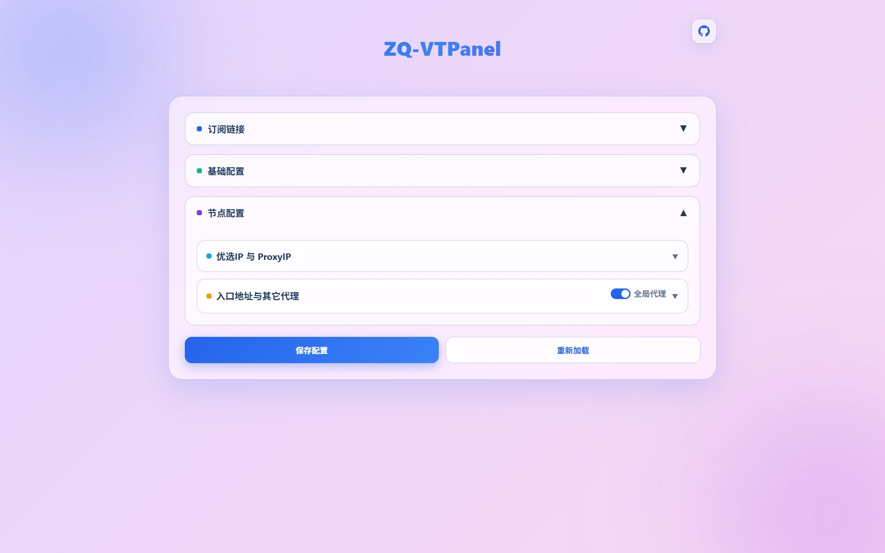

# ZQ-VTPanel

一个跑在 Cloudflare Workers 上的 VLESS / Trojan 节点面板，一份代码同时是节点隧道、订阅分发器和 Web 管理后台。

## 功能

- 面板三大块：订阅链接 / 基础配置 / 节点配置，毛玻璃动效界面，移动端自适应
- 优选IP、ProxyIP、入口地址、其它代理都支持多条，自由组合出节点
- 其它代理支持 socks5 / http / https / sstp / turn
- 全局代理开关：只走代理，或直连失败回退
- VLESS / Trojan 独立或同时出订阅，自动识别 Clash / Sing-Box / Surge 并调用 Sublink 转换
- ECH 加密、回退检测时间、优选IP 自动更新
- UUID 登录鉴权，路径与参数伪装混淆

## 部署步骤

### 1. 部署到 Workers

1. 登录 Cloudflare 控制台
2. 左侧进入 **Workers 和 Pages**
3. 点击 **创建应用程序** → 选择 **创建 Worker**
4. 输入 Worker 名称并创建
5. 进入在线编辑器：
   - 删除默认模板代码
   - 打开本仓库的 `_worker.js`，复制全部内容
   - 粘贴到 Cloudflare 在线编辑器中
6. 点击右上角 **保存并部署**
7. 创建 KV 命名空间：
   - 左侧进入 **存储和数据库**，点击 **KV**
   - 点击 **创建命名空间**，名称建议：`VTPanel`
8. 在 Worker 详情页绑定 KV：
   - 打开 Worker → **设置** → **变量** → **KV 命名空间绑定** → **添加绑定**
   - 变量名称：`VTPanel`
   - 选择刚创建的 KV 命名空间
   - 点击 **保存**
9. 绑定自定义域名（注意：不能使用 workers 默认域名）

### 2. 部署到 Pages

1. [下载 ZIP](https://github.com/bayueqi/ZQ-VTPanel/archive/refs/heads/main.zip)
2. 登录 Cloudflare → **Workers 和 Pages** → **创建应用程序** → 选择 **创建 Pages**
3. 选择 **直接上传**，上传下载的 ZIP 包，直接保存并部署
4. 创建 KV 命名空间：
   - 左侧进入 **存储和数据库**，点击 **KV**
   - 点击 **创建命名空间**，名称建议：`VTPanel`
5. 绑定 KV：进入 Pages 项目 → **设置** → **变量** → **KV 命名空间绑定** → **添加绑定**
   - 变量名称：`VTPanel`
   - 选择已创建的 KV 命名空间
6. 再次上传 ZIP 包并部署，接着访问域名（可以绑定自定义域名，也可使用 pages 默认域名）

## 使用

首次访问输入默认 UUID `ef9d104e-ca0e-4202-ba4b-a0afb969c747` 登录，登录后立即修改 UUID。

### 订阅链接

复制订阅链接 / 导出节点 / 扫码，导入客户端即可。

### 基础配置

| 配置 | 说明 |
|---|---|
| UUID | 登录凭据，也是节点凭据；修改后需用新 UUID 重新登录 |
| 协议类型 | VLESS / Trojan，至少选一个 |
| 订阅转换服务 | 自建 Sublink Worker 根地址，留空用内置默认 |
| ECH | 加密 SNI 绕过 DNS 污染；「高级」里可改 SNI 与 DoH 地址 |
| 回退检测时间 | 直连无响应多少毫秒后切换下一通道，默认 100 |

### 节点配置

**优选IP 与 ProxyIP**

- 优选IP：客户端入口，IP 与域名都行，可加备注；可点「自动优选」一键拉取，勾选「自动获取优选IP」后需手动在 Worker 加 Cron Trigger 定时更新
- ProxyIP：中转地址，可多条，与上面的优选IP 自由组合。填了 ProxyIP 后，每条「优选IP × ProxyIP」生成一个直连失败回退 ProxyIP 的节点；未填则只出直连节点

**入口地址 与 其它代理**

- 入口地址：客户端入口，可填优选IP或域名，留空用本项目域名；入口地址 × 其它代理，各出一组节点
- 其它代理：可多条，备注即节点名，支持 socks5 / http / https / sstp / turn；格式 `[协议://]user:pass@host:port`，不写前缀按 socks5
- 全局代理：开 = 只走其它代理；关 = 优先直连、失败回退其它代理

## 贡献

欢迎提交 Issue 和 Pull Request。
