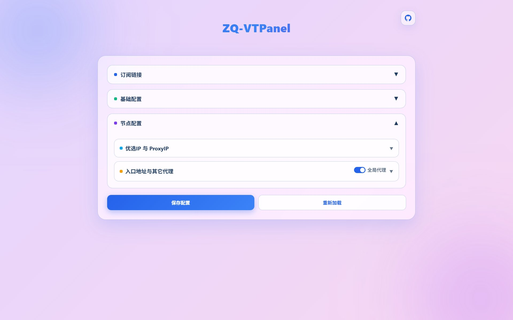

# ZQ-JKPanel

一个跑在 Cloudflare Workers 上的 VLESS / Trojan 节点面板。`_worker.js` 是核心（隧道、订阅分发、接口），`docs/` 是管理界面（静态页，由核心反代），两部分独立部署、互不影响。`jkpanel.js` 是面板的整份代码（界面与配置接口），可单独部署成一个 Worker 充当管理界面。

## 功能

- 面板三大块：订阅链接 / 基础配置 / 节点配置，毛玻璃动效界面，移动端自适应
- 优选IP/域名、ProxyIP、入口地址、其它代理都支持多条，自由组合出节点
- 其它代理支持 socks5 / http / https / sstp / turn
- 全局开关：只走代理，或直连失败回退
- VLESS / Trojan 独立或同时出订阅，自动识别 Clash / Sing-Box / Surge 并调用 subconverter 转换
- 传输类型 WebSocket / XHTTP / gRPC，可多选，同时出多套节点
- ECH 加密、优选IP 与其它代理自动拉取
- 密码登录鉴权，路径与参数伪装混淆

## 部署步骤

### 1. 发布面板页面

面板有两种部署方式，任选一种。

**方式一：静态页 `docs/`**，任意静态托管均可，以下用 GitHub Pages：

1. 仓库 **Settings** → **Pages**
2. **Source** 选择 **Deploy from a branch**，分支 `main`，目录 `/docs`，保存
3. 等待发布完成，得到访问地址

**方式二：独立 Worker `jkpanel.js`**

`jkpanel.js` 是面板的整份代码，含界面与配置接口。新建一个 Worker，粘贴 `jkpanel.js` 全部内容，绑定与核心相同的 KV（变量名 `JKPanel`），部署后绑定自定义域名，该域名即面板地址。

`_worker.js` 的默认面板地址是 `https://jkpanel.vpnjk.cc.cd`。面板地址与此不同时，部署核心 Worker 时用环境变量 `PANEL_URL` 指定。

### 2. 部署核心 Worker

1. 登录 Cloudflare 控制台
2. 左侧进入 **Workers 和 Pages**
3. 点击 **创建应用程序** → 选择 **创建 Worker**
4. 输入 Worker 名称并创建
5. 进入在线编辑器：
   - 删除默认模板代码
   - 打开本仓库的 `_worker.js`，复制全部内容
   - 粘贴到 Cloudflare 在线编辑器中
6. 点击右上角 **保存并部署**
7. 创建 KV 命名空间：
   - 左侧进入 **存储和数据库**，点击 **KV**
   - 点击 **创建命名空间**，名称建议：`JKPanel`
8. 在 Worker 详情页绑定 KV：
   - 打开 Worker → **设置** → **变量** → **KV 命名空间绑定** → **添加绑定**
   - 变量名称：`JKPanel`
   - 选择刚创建的 KV 命名空间
   - 点击 **保存**
9. 面板地址（可选，非默认地址时必填）：
   - 同一个页面 → **变量和机密** → **添加** → 类型选 **文本**
   - 变量名称：`PANEL_URL`，值为第 1 步得到的面板地址
10. 绑定自定义域名（注意：不能使用 workers 默认域名）

面板只能通过 Worker 域名访问。页面里的接口请求走同域相对路径，直接打开 Pages 地址取不到数据。

## 使用

首次访问输入默认密码 `admin` 登录，登录后立即修改密码。

### 订阅链接

复制订阅链接 / 导出节点 / 扫码，导入客户端即可。

### 基础配置

| 配置 | 说明 |
|---|---|
| 密码 | 面板登录凭据，默认 `admin`，登录后修改 |
| UUID | 节点凭据，也是订阅链接凭据 |
| 协议类型 | VLESS / Trojan，至少选一个 |
| 传输类型 | WebSocket / XHTTP / gRPC，至少选一个，可多选。节点名格式为 `协议-传输 备注`，协议 `V`（VLESS）/ `T`（Trojan），传输 `W` / `X` / `G`，如 `V-G 香港`。XHTTP 需客户端支持（mihomo 1.19.22 起、Xray 系新版）；gRPC 需部署在 Workers（Pages 不支持），并在 Cloudflare 面板开启 gRPC（网络 > gRPC）。Sing-Box 的订阅不出 XHTTP，Surge / Loon / Quantumult X 的订阅只出 WebSocket |
| gRPC 模式 | `gun` 单流（默认）或 `multi` 多连接复用一条 HTTP/2。`mode` 参数仅 Xray 系客户端读取，mihomo 侧固定单流 |
| gRPC UA | 覆盖 gRPC 客户端的 User-Agent，可点「获取当前 UA」填入浏览器 UA；留空用客户端自带。Clash 订阅写入 `grpc-opts.grpc-user-agent`，其余格式不含此项 |
| 订阅转换服务 | subconverter 服务根地址（ZQ-SubApi 即这一层），留空用内置默认；可用环境变量 `SUBCONVERTER_BASE` 指定 |
| 订阅转换配置文件 | ACL4SSR 规则预设或自填 `.ini` 地址，仅对 Clash 订阅生效；选「不使用」则用服务端默认规则 |
| ECH | 加密 SNI 绕过 DNS 污染；「高级」里可改 SNI 与 DoH 地址 |

### 节点配置

**优选IP/域名 与 ProxyIP**

- 优选IP/域名：客户端入口，支持 IP 与域名，均可带端口（如 `162.159.198.1:8443`、`store.ubi.com:443`），也可写 `[IPv6]:端口`，可加备注。点「获取优选IP/域名」从拉取源批量拉取，拉取源每行 `host[:端口][#备注]`，拉入的备注按类型写为「优选IP」或「优选域名」；面板上的结果点「保存配置」后生效。勾选「自动获取优选IP/域名」后，客户端每次拉取订阅时自动更新一次，只替换备注以「优选」开头的条目，手动填写的保留
- 列表超过约 7 条时在列表内部滚动，不撑长页面
- ProxyIP：中转地址，可多条，与上面的优选IP 自由组合。填了 ProxyIP 后，每条「优选IP × ProxyIP」生成一个直连失败回退 ProxyIP 的节点；未填则只出直连节点

**入口地址 与 其它代理**

- 入口地址：客户端入口，可填优选IP或域名，均可带端口，留空用本项目域名；入口地址 × 其它代理，各出一组节点
- 其它代理：可多条，备注即节点名，支持 socks5 / http / https / sstp / turn；格式 `[协议://]user:pass@host:port`，不写前缀按 socks5
- 其它代理自动拉取：点「自动拉取」填 API 地址（订阅源），勾选要拉取的协议类型（socks5/http/https/sstp），点「获取其它代理」从订阅源拉取，拉入的备注写为「优选」加原备注，替换备注以「优选」开头的旧条目，手动填写的保留，面板上的结果点「保存配置」后生效；勾选「自动获取其它代理」后，客户端每次拉取订阅时自动更新一次
- 全局：开 = 只走其它代理；关 = 优先直连、失败回退其它代理

## 贡献

欢迎提交 Issue 和 Pull Request。
