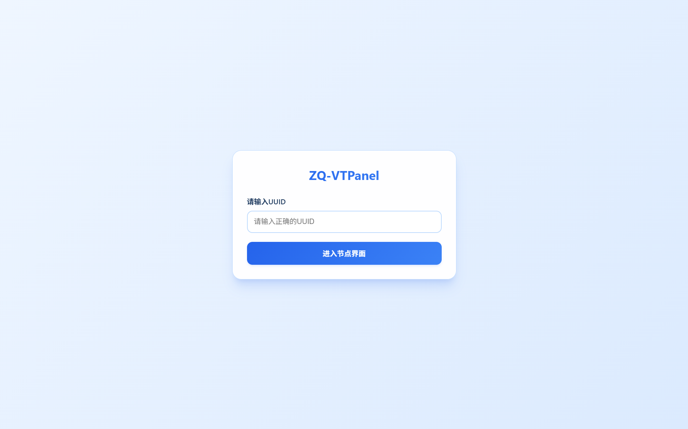
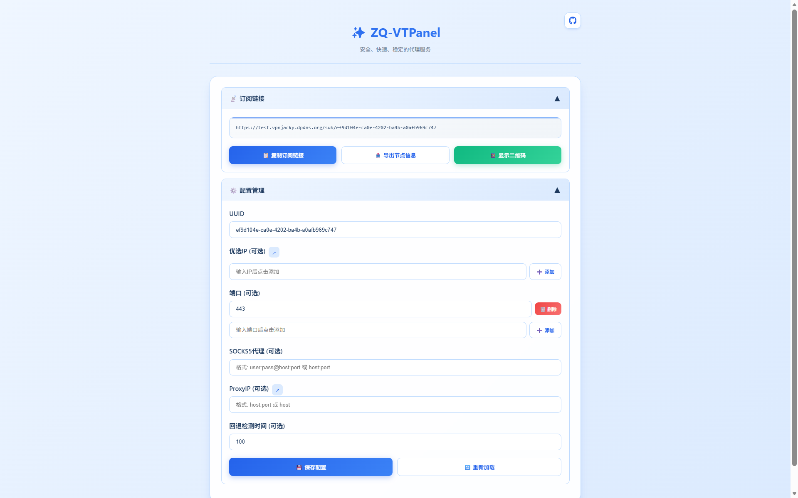

# ZQ-VTPanel

## 功能特点

- 🚀 **多条 ProxyIP 自由组合**：ProxyIP 与其它代理都支持添加多条；ProxyIP × 优选IP 自由组合，每条 ProxyIP 都会生成一组「优先直连、失败回退 ProxyIP」的节点
- 🔗 **入口地址 × 其它代理**：其它代理每条可带备注（用作节点名），并配一个「入口地址」（可填优选IP或域名，留空默认用本项目域名），入口地址与其它代理自由组合出节点
- 🎛️ **全局代理开关**：开启 = 只走其它代理不做直连；关闭（默认）= 优先直连、失败回退其它代理
- 📋 **协议类型自由切换**：VLESS / Trojan 独立勾选，可单独或同时生成
- 🌐 **其它代理多协议**：`socks5` / `http` / `https` / `sstp` / `turn`，填带协议前缀的完整地址即可，不写前缀按 `socks5` 处理
- 🎨 **三板块界面**：订阅链接 / 基础配置 / 节点配置，折叠下拉框 + 内层分组，桌面与移动端自适应
- 🔒 **安全验证**：UUID 验证确保只有授权用户能访问
- 🔀 **订阅转换服务可自建**：Clash / Sing-Box / Surge 订阅交由 Sublink Worker 转换，地址可在面板里修改
- 🛡️ **流量混淆**：参数和路径伪装，降低被检测风险
- 🔧 **自动优选IP**：支持配置优选IP API，手动或定时自动获取更新优选IP
- 🛰️ **ECH 加密**：启用后订阅自动注入 ECH 参数，绕过 DNS 污染
- ⚡ **高性能**：基于 Cloudflare Workers，全球加速

## 部署步骤

### 1. 部署到 Workers

1. 登录 Cloudflare 控制台
2. 左侧进入 **Workers 和 Pages**
3. 点击 **创建应用程序** → **创建 Worker**
4. 输入 Worker 名称并创建
5. 进入在线编辑器：删除默认模板代码，复制本仓库 `_worker.js` 全部内容粘贴进去
6. 点击右上角 **保存并部署**
7. 创建 KV 命名空间：左侧 **存储和数据库** → **KV** → **创建命名空间**，名称建议 `VTPanel`
8. 绑定 KV：Worker → **设置** → **变量** → **KV 命名空间绑定** → **添加绑定**，变量名 `VTPanel`，选择刚建的命名空间，保存
9. 绑定自定义域名（注意：不能使用 workers 默认域名）

### 2. 部署到 Pages

1. [下载 ZIP](https://github.com/bayueqi/ZQ-VTPanel/archive/refs/heads/main.zip)
2. 登录 Cloudflare → **Workers 和 Pages** → **创建应用程序** → **Pages** → **直接上传**，上传 ZIP 并部署
3. 创建 KV 命名空间（同上），并在 Pages 项目 → **设置** → **变量** → **KV 命名空间绑定** 绑定变量名 `VTPanel`
4. 再次上传 ZIP 部署，访问域名（可用 Pages 默认域名或绑定自定义域名）

## 使用说明

### 首次使用

1. 访问项目域名
2. 输入 `ef9d104e-ca0e-4202-ba4b-a0afb969c747` 进入节点界面
3. 按需填写三块配置：

**订阅链接**：复制订阅链接 / 导出节点信息 / 显示二维码

**基础配置**
- **UUID**：强烈建议修改，用于身份验证
- **协议类型**：VLESS / Trojan 独立勾选
- **订阅转换服务**：填你自建的 Sublink Worker 根地址（如 `https://sublink.example.com`）
- **ECH**：勾选「启用 ECH」，可展开高级设置填 SNI 与 DoH 地址
- **回退检测时间**：默认 100 毫秒，范围 1-5000

**节点配置**
- **优选IP 与 ProxyIP**：
  - 优选IP：入口 IP/域名列表（IP + 备注），自动生成节点（没填 ProxyIP 出直连节点，填了 ProxyIP 则出直连+ProxyIP 回退节点）；可点「自动优选」配置 API 并「获取优选IP」一键拉取
  - ProxyIP：中转 IP 列表（多条，无备注），每条与优选IP 自由组合成「直连+ProxyIP」回退节点
- **入口地址与其它代理**：
  - 入口地址：IP 或域名列表（留空默认本项目域名），与其它代理自由组合
  - 其它代理：列表，每条填代理地址 + 备注（备注用作节点名）
  - 全局代理开关：开 = 只走其它代理；关 = 优先直连、失败回退其它代理

4. 点击 **保存配置**，订阅内容实时刷新

### 自动优选 IP（可选）

- 点「自动优选」展开设置，填优选IP API（默认 `https://ipdb.api.030101.xyz/?type=bestcf`）
- 勾选「自动获取优选IP」后，在 Workers 后台 → Triggers → Cron Triggers 加定时任务（如 `0 */6 * * *` 每 6 小时一次）
- 点「获取优选IP」可立即手动拉取

## 连接方式说明

| 生成来源 | 节点行为 | 前置条件 |
|---------|---------|---------|
| **优选IP** | 没填 ProxyIP：直连优选IP；填了 ProxyIP：优先直连、失败回退 ProxyIP（每条 ProxyIP 出一组，不再单独出直连节点） | 填优选IP（默认本项目域名） |
| **入口地址 × 其它代理** | 全局代理关：优先直连，失败回退其它代理；开：只走其它代理 | 填其它代理 |

> 节点备注：其它代理节点直接用「其它代理」那条的备注作节点名（未填备注则显示协议名 `SOCKS5`/`HTTP`/`HTTPS`/`SSTP`/`TURN`）。

> 节点数量公式：节点总数 =（优选IP数 × ProxyIP数（无 ProxyIP 时按 1 算）+ 入口地址数 × 其它代理数）× 协议数。

## 流量混淆特性

- **路径伪装**：WebSocket 路径伪装为正常 API 风格（如 `/api/v1/data`）
- **参数混淆**：使用简短无意义的参数名（`t`/`d`/`s`/`p`）替代明显代理参数
- **随机参数**：每个节点添加随机 `v` 参数增加流量多样性
- **订阅兼容**：标准 Base64 编码，兼容主流客户端

## 贡献

欢迎提交 Issue 和 Pull Request！
